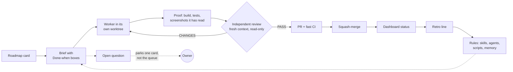

# agentic-sdlc

This is the process one developer uses to build several Apple apps with Claude Code agents: one long-lived lead session picks roadmap cards, hands each to a background worker in its own git worktree, and merges only after proof, an independent review and green CI.
The files here are the working ones (skills, agent definitions, hooks, machine-safety scripts, dashboard tooling), copied from the live setup by [scripts/sync.py](scripts/sync.py) with app names and private details replaced.
It is also meant as a restore kit: the repo plus an interview about the real apps should bring a new machine or a new Claude account back to this state. So far that has been tested in a temporary home folder only, not on a new account or a second machine.

Last synced with the live system: 2026-11-18. The apps are unreleased, so they appear as FieldApp (a field-data collection app, cards `FLD-n`) and StudyApp (a study app, cards `STU-n`).

## Restore from zero

```sh
git clone <this repo> && cd agentic-sdlc
python3 bootstrap/install.py --dry-run   # prints every file and settings change, writes nothing
python3 bootstrap/install.py             # installs skills, agents, hooks, scripts, dashboard tools, rules
```

Then say to Claude Code: "bootstrap the SDLC from this repo". The [bootstrap skill](skills/bootstrap/SKILL.md) interviews you for what a public repo cannot hold (the real apps, the build machine's limits, guardrails, model choices) and writes the answers to a private `~/.claude/lead/config.json`, never into the repo. Details, uninstall and what cannot be restored: [BOOTSTRAP.md](BOOTSTRAP.md). What the restore test proves and what it does not: [docs/restore-verification.md](docs/restore-verification.md).

## The loop



Detail: [docs/loop.md](docs/loop.md). The limiting resource is one shared build machine, not the models: [docs/lane.md](docs/lane.md).

## Roles

| Role | Model class | Does | Never does |
|---|---|---|---|
| Lead | Fable (long-lived session) | Picks cards, writes briefs, runs the lane, reads hand-backs and pictures, merges, records status, writes the retro | Builds cards; merges without a separate review |
| Implementer | Sonnet with a Fable advisor; Fable alone for UI-heavy cards | One card (or a bundle) in a worktree; build, tests, screenshots; hand-back file | Pushes before the lead says; edits cards; merges |
| Reviewer | Fable for Sonnet-built code, Opus for Fable-built code | Reads card, diff and pictures with fresh context; returns PASS or CHANGES | Edits, builds, runs tests; sees the implementer's reasoning |
| Scout | Haiku | Read-only searches | Writes |
| Illustrators | parallel agents, one per style | Render, critique, fix; options shown side by side ([docs/design-work.md](docs/design-work.md)) | Declares anything final |
| Owner | human | Irreversible and taste decisions; changes the rules | Tests builds by hand |

The reviewer is never the model that wrote the code, gets a fresh context every round, and is given the card, the diff and the screenshots but not the implementer's explanation. A reviewer that shares the author's context tends to accept the author's reasoning. Protocol and real findings: [docs/independent-review.md](docs/independent-review.md). Definitions: [agents/card-implementer.md](agents/card-implementer.md), [agents/card-reviewer.md](agents/card-reviewer.md).

## What the human still decides

- Anything irreversible or outward-facing: a direct push to an app's `main`, store submissions, legal or money matters, deleting roadmap content, sending mail or posting. The [guard hook](hooks/guard.py) asks or denies for the ones a shell command can show; the rest rests on the lead skill and the auto-mode rules. See [docs/guardrails.md](docs/guardrails.md).
- Taste. Visual choices arrive as two or three real screenshots, not descriptions. Design work is "an iteration" until the owner accepts it.
- Scope and pricing.
- The rules themselves. Any rule can be renegotiated, but the lead must bring readings and one proposed replacement.

A question parks one card and the lead moves on. Small reversible choices are decided by the lead after about 15 minutes and listed on the dashboard under "Decided for you", where the owner can accept or reverse them: [docs/dashboard.md](docs/dashboard.md).

## Numbers

From `python3 scripts/metrics.py`, which reads [data/merged-prs.tsv](data/merged-prs.tsv) and [data/reviewer-runs.tsv](data/reviewer-runs.tsv). Period: the first 4.5 days of the lead loop, 2026-11-12 03:52 to 2026-11-16 16:04 UTC, two apps, one owner.

| Figure | Value | How it was derived |
|---|---|---|
| PRs merged into `dev` | 30 (6.7 per day; 3 to 11 per day) | GitHub merge times of the two app repos |
| Roadmap cards in those PRs | 46 (about 10 per day) | distinct card ids in the PR titles; related small cards are bundled |
| Review rounds per PR | median 2, mean 2.8, max 6 | the "Review: PASS" comment on each PR, read by hand |
| PRs whose first review returned CHANGES | 24 of 30 (5 passed first time, 1 not stated) | same comments |
| Reviewer runs | 87: 60 CHANGES, 27 PASS | final verdict in each reviewer agent's transcript; includes code-only reviews before a simulator run and narrow re-reviews |

What these do not show: there is no baseline (the setup before the lead loop was not measured the same way), no count of defects that got past review, and no cost figure. Most cards are small (S or M). A 69% CHANGES rate reflects a strict protocol as well as real defects; a "Done when" item without evidence is blocking.

Examples of what review caught, each from a PR's review comment or the [retro log](RETRO.md):

- A regenerated data file had lost the page part of 216 source links because the generator fell back silently when its cache was missing. The worker's tests passed.
- A new layout rule cut long two-word names in every list. The sample name fit by luck; only a picture with a long name showed it.
- A CSS filter built as a denylist kept losing to the next trick over six review rounds, until it became an allowlist.
- A sync merge rule had two holes that the tests could not see because every test started from a settled state.
- A fix keyed on a device fold state removed the only Share control in another pose that shares that state.
- A pixel test "proved" a fix by reading through translucent glass.

## What broke

| What happened | The rule it produced |
|---|---|
| The build machine crashed twice in one day with several simulator workers and CI jobs running (2026-11-04) | One lane: a single simulator worker or a single CI run. [scripts/macgate.sh](scripts/macgate.sh) must pass before a boot or a push |
| A "simulator-free" worker pushed; its CI booted a simulator during another worker's run; swap 16 GB, load 260 to 320, run wasted (2026-11-11) | A PR push counts as the lane. Workers hold pushes until the lead says |
| The stop rule stopped healthy runs: a cold boot alone tripped it, three versions in a row | The rule was renegotiated with readings each time; [scripts/macstop.sh](scripts/macstop.sh) carries the history in its comments |
| The lead accepted a hand-back and nearly merged commits no reviewer had read | Lead acceptance is not a review. Every commit after the last pass gets a fresh reviewer or a stated mechanical check |
| A lockfile written on macOS with a newer npm failed `npm ci` on the Linux runner after local checks passed | Verify lockfiles with the CI's npm major before pushing. Whole thread: [examples/FLD-328](examples/FLD-328/brief.md) |
| A machine restart killed every worker and wiped `/tmp`; earlier, a dead worker left an unrun commit that read as finished | Hand-backs must be complete enough to restart from; nothing worth keeping in `/tmp`; an unrun commit proves nothing |
| A worker waited 80 minutes on a permission prompt nobody saw | Short single-purpose shell calls; the [attention hook](hooks/attention.py) logs waiting sessions |
| The lead removed a worktree when its PR merged; the worker was still using it | Worktrees go only after the final hand-back |

The full record, one line per card or incident, is [RETRO.md](RETRO.md). When each rule or tool arrived: [CHANGELOG.md](CHANGELOG.md). Open problems: [docs/limits.md](docs/limits.md).

## How to read this repo

| If you have | Open |
|---|---|
| Two minutes | [examples/FLD-328](examples/FLD-328/brief.md): one real brief, its [hand-back](examples/FLD-328/handback.md), the [review request](examples/FLD-328/review-request.md) and the [review](examples/FLD-328/review.md) |
| Five minutes | [skills/lead-loop/SKILL.md](skills/lead-loop/SKILL.md), the lead's operating manual, and [hooks/guard.py](hooks/guard.py) |
| Longer | [docs/](docs/loop.md): loop, [lane](docs/lane.md), [briefs](docs/briefs.md), [review](docs/independent-review.md), [dashboard](docs/dashboard.md), [guardrails](docs/guardrails.md), [memory and rules](docs/memory-and-rules.md), [design work](docs/design-work.md), [limits](docs/limits.md), [adopting pieces](docs/adopting.md) |

| Folder | Contents | Origin |
|---|---|---|
| `skills/`, `agents/`, `hooks/`, `scripts/*.sh` | The lead's skills, the worker and reviewer definitions, the guard and attention hooks, the machine gate and stop scripts | Live files, sanitised; each has a "Live version as of" line |
| `dashboard/` | Data model, card tool, page source, tests, an example seed, [RESTORE.md](dashboard/RESTORE.md) | Live files, plus restore helpers written for this repo |
| `examples/`, `RETRO.md` | A real card thread; the retro log | Live files, sanitised |
| `rules/` | The durable rules as dated statements with the incident and the reason | Rewritten from the lead's memory |
| `docs/`, `templates/`, `bootstrap/`, `config/` | Explanations, blank templates, the installer, the config schema with example values | Written for this repo |

Values such as FieldApp, `FLD-123`, `OWNER` and the machine's limits are examples. The real ones live in the private config ([config/SCHEMA.md](config/SCHEMA.md)).

## Status

- In daily use since 2026-11-11 on two unreleased apps. Nothing here has shipped to users yet, so there is no production feedback.
- Kept current by `python3 scripts/sync.py` on the owner's machine: it re-copies the live files, applies the replace map and patches (kept private, because they name what they remove), refreshes `data/`, runs the forbidden-pattern scan and fails on any hit.
- CI on every push ([.github/workflows/check.yml](.github/workflows/check.yml)), on ubuntu: the scan (generic patterns only; the private names are checked on the owner's machine), a link check, the README numbers script, the guard hook's self-test, the dashboard tests and the restore test.
- Written for Claude Code. Model names and CLI flags are those in use on the sync date. See [NOTICE](NOTICE). License: [MIT](LICENSE).
